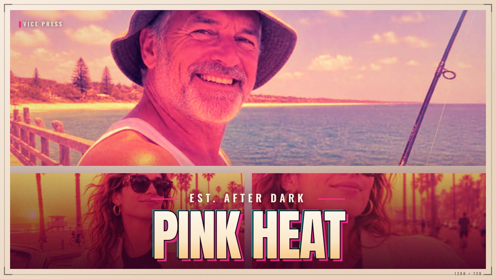

# VICE PRESS

[](https://make.fun/bounty/gta6-cover-art-01?utm_source=github&utm_medium=readme&utm_campaign=gta6-cover-art-01)
[](https://make.fun/bounty/gta6-cover-art-01/leaderboard?utm_source=github&utm_medium=readme&utm_campaign=gta6-cover-art-01)
[](https://make.fun/bounty/gta6-cover-art-01?utm_source=github&utm_medium=readme&utm_campaign=gta6-cover-art-01)

An offline multi-panel poster studio. Drop your own photos in, VICE PRESS deals them out across a poster layout,
runs a sunset or neon colour grade over them, sets your caption in huge capitals and exports a PNG in the size you
post at. The photos never leave the machine: they are read in the tab and drawn straight onto a canvas, and the
page makes no network request at all.



## What it does

- **Any photo.** File picker or drag-and-drop, several at once. Each panel crops its own photo: click a panel,
  drag to pan, wheel to zoom, or hit Fit / Fill. One photo fills every panel with a different crop; several photos
  are matched to the panels whose shape suits them.
- **Six layouts.** Banner, hero stack, quad, triptych, magazine (a typographic column beside two photos) and full
  bleed — thick gutters on a printed board, not hairline grids.
- **Five colour grades.** Vice Sunset, Neon Night, Heat Wave, Chrome Teal and Golden Hour: per-channel curves and
  a luminance split tone, then film grain, a vignette, a light leak and a touch of edge aberration.
- **Lettering.** The caption is auto-fitted to its band in Anton, with a magenta offset, a teal ghost and an
  outline so it holds over any photo; the tagline is set in Oswald. Both faces ship here under the SIL Open Font
  License, in `app/fonts/` with their licences.
- **Export.** One button for the size you are on — 1080 × 1080, 1080 × 1350 or 1920 × 1080 — or all three at once.
  The preview and the export call the same `drawCover(canvas, state)`, so what you see is the file you get.

Nothing in the app is taken from Rockstar Games: the layouts, the grades, the lettering and the VICE PRESS mark
are all drawn by this code, and no official logo, artwork, character or font appears anywhere in it.

## Run it

```
node serve.ts
```

Then open <http://localhost:8080> in desktop Chrome. There is no build step — `app/` is plain static files.

## Build the entry

```
mkdir -p out && MAKEFUN_OUTPUT_DIR=out node main.ts
```

That copies `app/` and `screenshots/` into the output directory and writes `dossier.json`.

To retake the four screenshots in `shots.json` with headless Chrome:

```
node serve.ts --port 8123 &
node shoot.ts --port 8123
```

## Source

| File | What is in it |
| --- | --- |
| `app/src/main.js` | the state object, the rail's pickers, drag-and-drop, panel selection and panning |
| `app/src/cover.js` | `drawCover` — board, art layer, scrim, lettering, film effects, printed edge |
| `app/src/layouts.js` | `layoutBanner`, `layoutHeroStack`, `layoutQuad`, `layoutTriptych`, `layoutMagazine`, `layoutFullBleed` |
| `app/src/grade.js` | `gradeViceSunset`, `gradeNeonNight`, `gradeHeatWave`, `gradeChromeTeal`, `gradeGoldenHour` and the effects |
| `app/src/type.js` | `fitDisplayType`, `drawCaption`, `drawTagline`, `drawStudioMark` |
| `app/src/photos.js` | loading photos, dealing them out to panels, the pan / zoom crop |
| `app/src/export.js` | rendering at the post size and saving the PNG |
| `app/src/shots.js` | the deterministic `?shot=` scenes the screenshots are taken from |

## Licence

MIT — see [LICENSE](LICENSE). The two sample photos in `app/samples/` come from the bounty kit. Anton and Oswald
are used under the SIL Open Font License; the full licence text sits beside each font in `app/fonts/`.
